# Misja AED – dane na ratunek (prototyp w kodzie dane.gov.pl)

Prototyp rozwiązania, które pozwala zebrać w portalu **dane.gov.pl** ogólnopolski, otwarty i aktualny zbiór danych
o defibrylatorach AED z wielu rozproszonych źródeł – według **jednego wzorcowego zakresu danych (standard AED v1)** –
i udostępnić go służbom ratunkowym i obywatelom (mapa, „najbliższy AED”, API).

Rozwiązanie jest zbudowane **wewnątrz istniejącego portalu**, z jego mechanizmów: zbiory, zasoby, panel dostawcy
(Django admin), walidacja zasobów w kolejce Celery `resources`, Elasticsearch, API JSON:API (Falcon), tagi,
kategorie, licencje, formularz uwag do zasobu, tłumaczenia PL/EN. Całość jest wyłączona flagą `AED_ENABLED`.

## Co jest w prototypie

| Element | Gdzie |
|---|---|
| Wzorcowy zakres danych AED v1 (Frictionless Table Schema, jedno źródło prawdy) | `backend_latest/mcod/aed/schema/aed_v1.json` |
| Plik konkursowy XLSX (arkusze `dane`, `opis_pol`, `slowniki`, `zasady_pliku`), CSV, JSON | `docs/aed/wzorcowy_zakres_danych_AED_v1.xlsx`, `.csv`, `aed_v1.json` (generowane `manage.py export_aed_standard`) |
| Oznaczenie zasobu „Standard AED v1” w panelu dostawcy + raport walidacji (zakładka) | `Resource.data_standard`, `mcod/aed/admin.py` |
| Walidator (CSV/XLSX, 33 reguły: 25 ERROR, 8 WARNING; komunikaty PL/EN; RODO) | `mcod/aed/validation.py`, `opening_hours.py` |
| Zbiór krajowy: agregacja, deduplikacja, priorytet źródeł, powiązania ze źródłami | `mcod/aed/aggregation.py`, `national.py`, tabela `aed_source_link` |
| Publikacja jako zwykły zbiór portalu (CSV, GeoJSON, CSV powiązań) + codzienna aktualizacja | `mcod/aed/national.py`, zadanie `build_aed_national_dataset_task` |
| Indeks Elasticsearch `aed` (geo_point) i API `/aed…` | `mcod/aed/documents.py`, `search.py`, `record_views.py`, `views.py` |
| Gotowość AED liczona w chwili zapytania (`gotowosc`, `otwarte_teraz`) | `mcod/aed/readiness.py` |
| Frontend: strona akcji, mapa „najbliższy AED”, kreator dysponenta, odznaki | `frontend_latest/src/app/pages/aed/` |

## Architektura

```mermaid
flowchart LR
  subgraph Dysponenci danych
    D1[Właściciel / JST / aplikacja / OSM]
  end
  D1 -- "szablon XLSX/CSV" --> W[Kreator /aed/udostepnij]
  W -- "POST /aed/validate (bez zapisu)" --> V[Walidator AED v1]
  D1 -- "zasób w panelu dostawcy\n+ Standard AED v1" --> R[(Resource + ResourceFile)]
  R -- "kolejka Celery resources\n(istniejący pipeline + krok AED)" --> V
  V --> REP[(AedValidationReport)]
  REP -- "zasoby bez ERROR" --> AGG[Agregacja i deduplikacja\ncodziennie 03:30]
  AGG --> NAT[(AedRecord + aed_source_link)]
  NAT --> ES[(Elasticsearch: indeks aed\ngeo_point)]
  NAT --> PUB[Zbiór „Defibrylatory AED w Polsce –\nzbiór krajowy”: CSV, GeoJSON, powiązania]
  ES --> API["API /aed, /aed/nearest, /aed/{id}, /aed/stats\n+ gotowość liczona w chwili zapytania"]
  API --> FE[Frontend: /aed, /aed/mapa]
  FE --> U[Obywatel, dyspozytor]
  PUB --> U
```



## Uruchomienie lokalne

Wymagania: środowisko deweloperskie portalu (`backend_latest/README.md`, Docker Compose) i Node ≥ 20.10.

```bash
# backend – .env
AED_ENABLED=True
AED_CAMPAIGN_NAME="Misja AED"           # nazwa akcji (placeholder – przygotowuje zespół)
AED_CAMPAIGN_SLOGAN="Dane na ratunek"   # hasło
AED_CAMPAIGN_LOGO_URL=                  # adres logo
# AED_NATIONAL_ORGANIZATION_ID=         # instytucja zbioru krajowego (wypisze ją aed_demo_data)

python manage.py migrate
python manage.py search_index --create --models aed.AedRecord
python manage.py search_index --rebuild -f --models resources.Resource   # nowe pola data_standard, aed_validation
python manage.py aed_demo_data                 # 3 fikcyjnych dostawców (Otwock, Warszawa, Kraków) + zbiór krajowy
python manage.py export_aed_standard --out docs/aed/   # plik konkursowy XLSX/CSV/JSON

# frontend
cd frontend_latest && npm install && npm run start-local
# http://localhost:4200/pl/aed
```

Przycisk panelu dostawcy w środowisku lokalnym otwiera `https://admin.mcod.local`. Lokalny superużytkownik
loguje się przez formularz na tej stronie; konta lokalne nie działają w produkcyjnym panelu dane.gov.pl.

Na Windowsie (checkout z `core.autocrlf=true`) do testów backendu służą skrypty
`docs/aed/scripts/backend.sh` i `docs/aed/scripts/lint_backend.sh` (opis w `PLAN.md`).

### Testy

```bash
# backend (pytest, w kontenerze z repozytorium)
docker compose -f docker-compose.local.yml run mcod-local-tests mcod/aed --no-cov
# frontend
npm test -- src/app/pages/aed        # Jest
npm run e2e:aed                      # Playwright: responsywność 1440/360, klawiatura, zrzuty ekranu (API zamockowane)
npm run lint
```

## Endpointy API

Prefiks i format jak w reszcie API portalu (`https://api.dane.gov.pl/1.4/…`, JSON:API). Istnieją tylko przy `AED_ENABLED=True`.

| Metoda i ścieżka | Opis |
|---|---|
| `GET /aed` | Lista rekordów zbioru krajowego. Filtry: `miejscowosc`, `kod_teryt_gminy` (prefiks), `status_urzadzenia`, `dostep_publiczny`, `otwarte_teraz`, `gotowosc`, `bbox=min_lon,min_lat,max_lon,max_lat`; `page`, `per_page`; `klastry=true&precyzja=1..12` → `meta.aggregations.klastry` (mapa) |
| `GET /aed/nearest?lat=&lon=&limit=5&max_km=2` | Najbliższe AED posortowane po odległości (`odleglosc_m`); domyślnie bez `CZASOWO_NIEDOSTEPNY` (`include_unavailable=true`); te same filtry co `/aed` |
| `GET /aed/{id_aed_krajowe}` | Szczegóły i lista źródeł (`zrodla`: dysponent, źródło, id w źródle, zasób, zbiór, źródło rozstrzygające) |
| `GET /aed/stats` | Liczniki: liczba AED, dysponentów, zasobów źródłowych, % rekordów z datą ważności elektrod, rozkład gotowości |
| `GET /aed/schema` | Schemat AED v1 (JSON) |
| `GET /aed/template.csv`, `GET /aed/template.xlsx` | Szablony generowane ze schematu (`?przyklady=true` – z 3 fikcyjnymi wierszami) |
| `POST /aed/validate` | Multipart `file` (CSV/XLSX, ≤ 10 MB, ≤ 50 000 wierszy) → raport walidacji; **nic nie jest zapisywane ani publikowane**; limit zapytań |
| `GET /aed/reports/{resource_id}` | Ostatni raport walidacji opublikowanego zasobu AED |
| `GET /aed/config` | Nazwa, hasło i logo akcji (`AED_CAMPAIGN_*`) dla frontendu |
| `GET /resources/{id}` (istniejący) | dodatkowo `data_standard` i `aed_validation`; `GET /resources?data_standard[terms]=AED_V1` |

Pola wyliczane (nigdy w plikach): `gotowosc` = `GOTOWY` / `WYMAGA_UWAGI` / `NIEZNANY` / `NIEGOTOWY`, `otwarte_teraz` (`true`/`false`/`null`).
AED `NIESPRAWNY` są ukryte; AED o gotowości `NIEZNANY` są pokazywane („lepszy niepotwierdzony AED niż żaden”).

## Pliki dokumentacji

- `PLAN.md` – plan, decyzje, postęp faz, znane problemy środowiska,
- `KROKI_UZYTKOWNIKA.md` – kroki obywatela, dyspozytora i dysponenta danych,
- `OGRANICZENIA.md` – ograniczenia prototypu,
- `ZRZUTY_EKRANU.md` – lista ekranów do prezentacji (+ `screenshots/`),
- `wzorcowy_zakres_danych_AED_v1.xlsx` / `.csv` / `aed_v1.json` – wzorcowy zakres danych.
